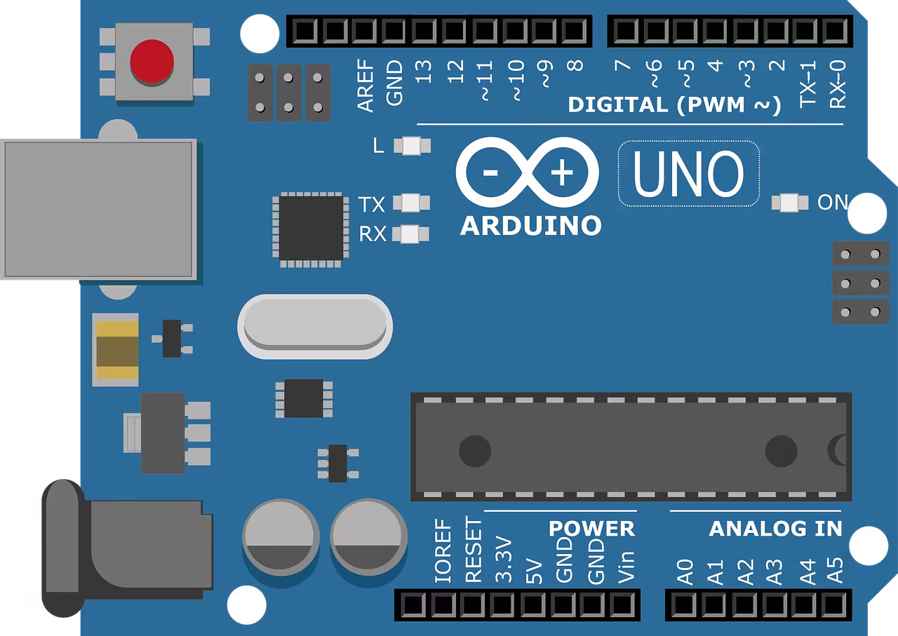
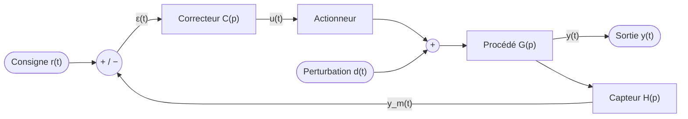
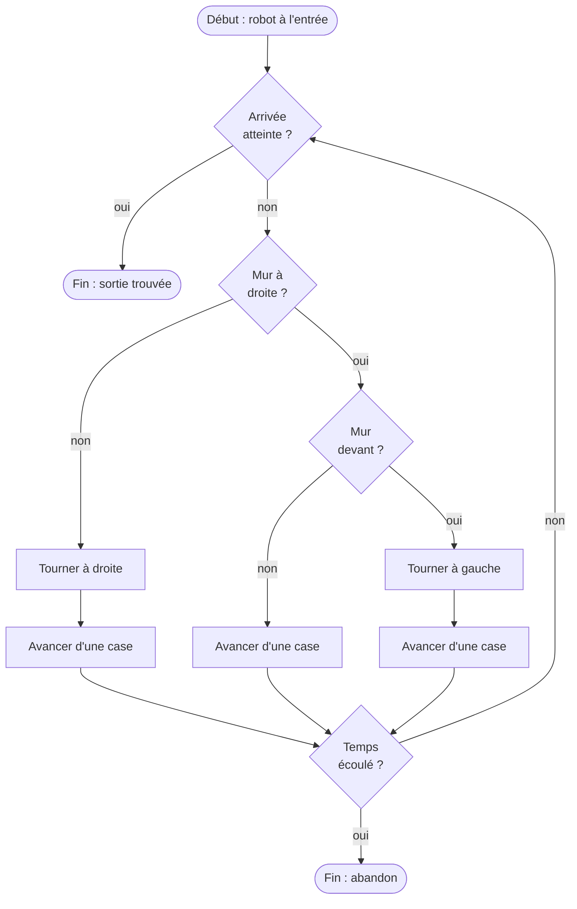

<!-- nohf -->
# Exemple de document

**Auteur** : Votre nom · **Date** : à compléter

Ce document d'exemple montre ce que l'outil sait faire : texte, tableaux, code, formules LaTeX, diagrammes. Pour l'utiliser :

1. renommez `exemple.md` **et** `exemple.jsonc` avec le même nouveau nom (ex. `MonDoc.md` / `MonDoc.jsonc`) ;
2. remplacez l'image `media/exemple_blague.jpg` par la vôtre ;
3. remplacez ce texte par le vôtre et lancez `npm run dev`.

\newpage

# Table des matières

<!-- TOC -->

<b>• [Exemple de document](#exemple-de-document)</b><br>
<b>• [Table des matières](#table-des-mati%C3%A8res)</b><br>
<b>• [Bases du Markdown](#bases-du-markdown)</b><br>
<b>• [1. Texte et mise en forme](#1-texte-et-mise-en-forme)</b><br>
<b>• [2. Images](#2-images)</b><br>
<b>• [3. Code coloré](#3-code-color%C3%A9)</b><br>
<b>• [Formules LaTeX](#formules-latex)</b><br>
<b>• [1. Résoudre une équation du second degré](#1-r%C3%A9soudre-une-%C3%A9quation-du-second-degr%C3%A9)</b><br>
<b>• [2. Systèmes, matrices et alignements](#2-syst%C3%A8mes-matrices-et-alignements)</b><br>
<b>• [3. Sommes, limites, intégrales](#3-sommes-limites-int%C3%A9grales)</b><br>
<b>• [Diagrammes Mermaid](#diagrammes-mermaid)</b><br>
<b>• [1. Système asservi : schéma-bloc en boucle fermée](#1-syst%C3%A8me-asservi--sch%C3%A9ma-bloc-en-boucle-ferm%C3%A9e)</b><br>
<b>• [2. Organigramme : robot qui résout un labyrinthe](#2-organigramme--robot-qui-r%C3%A9sout-un-labyrinthe)</b><br>
<b>• [Conclusion](#conclusion)</b><br>
<b>• [1. Pour aller plus loin : configuration via le fichier .jsonc](#1-pour-aller-plus-loin--configuration-via-le-fichier-jsonc)</b>

<!-- /TOC -->

\newpage

# Bases du Markdown

## 1. Texte et mise en forme

Du texte en **gras**, en *italique*, du `code en ligne`, des émojis et smileys (🚀, 💡, ⚡, 🤖, ✨, 😊) et un [lien interne vers la partie LaTeX](#formules-latex).

- Liste à puces
  - Sous-élément
- [x] Tâche faite
- [ ] Tâche à faire

| Fruit | Couleur | Prix au kg |
|-------|:-------:|-----------:|
| Pomme | rouge | 2,40 € |
| Banane | jaune | 1,90 € |
| Kiwi | vert | 4,10 € |

## 2. Images

Exemple d'une grande image en .jpg avec balise markdown :


Exemple d'une petite image en .png avec balise HTML pour choisir la largeur :



## 3. Code coloré

```c
int main(void) {
  HAL_Init();
  while (1) {
    HAL_GPIO_TogglePin(LED_GPIO_Port, LED_Pin);
    HAL_Delay(500);
  }
}
```

```python
def pid(e, e_prec, somme, kp, ki, kd, dt):
    somme += e * dt
    u = kp * e + ki * somme + kd * (e - e_prec) / dt
    return u, somme
```

# Formules LaTeX

## 1. Résoudre une équation du second degré

Soit à résoudre $ax^2 + bx + c = 0$ avec $a \neq 0$. On calcule le discriminant :

$$\Delta = b^2 - 4ac$$

Les solutions dépendent de son signe :

$$
x =
\begin{cases}
\dfrac{-b \pm \sqrt{\Delta}}{2a} \in \mathbb{R} & \text{si } \Delta > 0 \ (\text{deux racines})\\[2mm]
-\dfrac{b}{2a} & \text{si } \Delta = 0 \ (\text{racine double})\\[2mm]
\dfrac{-b \pm i\sqrt{-\Delta}}{2a} \in \mathbb{C} & \text{si } \Delta < 0 \ (\text{racines complexes})
\end{cases}
$$

Application : $x^2 - 5x + 6 = 0$, d'où $\Delta = (-5)^2 - 4 \times 1 \times 6 = 1$ et

$$x_1 = \frac{5 - 1}{2} = 2 \qquad x_2 = \frac{5 + 1}{2} = 3$$

\samepage
## 2. Systèmes, matrices et alignements

Un système linéaire s'écrit, puis se résout ligne par ligne grâce à l'environnement `aligned` :

$$
\left\{
\begin{aligned}
2x + y &= 5 \\
x - y &= 1
\end{aligned}
\right.
\iff
\begin{pmatrix} 2 & 1 \\ 1 & -1 \end{pmatrix}
\begin{pmatrix} x \\ y \end{pmatrix}
=
\begin{pmatrix} 5 \\ 1 \end{pmatrix}
$$

Par la méthode de Cramer, avec $\det A = -3$ :

$$
x = \frac{\begin{vmatrix} 5 & 1 \\ 1 & -1 \end{vmatrix}}{\det A} = \frac{-6}{-3} = 2
\qquad
y = \frac{\begin{vmatrix} 2 & 5 \\ 1 & 1 \end{vmatrix}}{\det A} = \frac{-3}{-3} = 1
$$

## 3. Sommes, limites, intégrales

$$\sum_{k=1}^{n} k = \frac{n(n+1)}{2} \qquad \lim_{x \to 0} \frac{\sin x}{x} = 1 \qquad \sum_{k=0}^{\infty} \frac{1}{2^k} = 2$$

$$\int_{-\infty}^{+\infty} e^{-x^2}\,\mathrm{d}x = \sqrt{\pi} \qquad \frac{\partial^2 u}{\partial t^2} = c^2 \, \nabla^2 u$$

Un calcul en plusieurs étapes, avec alignement sur le signe égal :

$$
\begin{aligned}
(a + b)^2 &= a^2 + 2ab + b^2 \\
          &= (a - b)^2 + 4ab \\
          &\geq 4ab \quad \text{si } a, b \geq 0
\end{aligned}
$$

\samepage
# Diagrammes Mermaid

## 1. Système asservi : schéma-bloc en boucle fermée

Boucle de régulation avec correcteur, perturbation et capteur dans la chaîne de retour :



## 2. Organigramme : robot qui résout un labyrinthe

Algorithme du « suiveur de mur droit » : losange = décision, rectangle = action, bulle = début / fin.



# Conclusion

## 1. Pour aller plus loin : configuration via le fichier .jsonc

Chaque document Markdown `nom.md` est associé à son fichier de configuration `nom.jsonc` (format JSON supportant les commentaires). Ce fichier permet de contrôler l'ensemble du rendu et des sorties sans modifier le contenu du document :

- **Informations générales & HTML** : titre de l'onglet et du document (`title`), icône/favicon (`icon`), langue, thème initial (`theme`: `light`, `dark` ou `auto`), intégration autonome des images dans un seul fichier HTML (`embedImages`), et largeur du sommaire latéral (`layout.sidebarWidth`).
- **Numérotation automatique** (`numbering`) : choix du style par niveau de titre (`decimal`, `roman`, `alpha`), du séparateur, et de la numérotation cumulative (ex. `2.1.`).
- **Sommaire dans le document** (`toc`) : niveaux de titres à lister (`range: [1, 2]`), sommaire repliable (`collapsible`) et symboles personnalisés.
- **Mise en page PDF** (`pdf`) : format de papier (`A4`, `A3`, `Letter`...), orientation portrait ou paysage (`landscape`), marges personnalisées, sauts de page automatiques avant certains niveaux (`pageBreakBefore`), et configuration dynamique des **en-têtes et pieds de page** (`header`, `footer`) avec des variables comme `{page}`, `{pages}`, `{title}`, `{h1}`, `{h2}`...
- **Apparence visuelle** (`style`) : typographies, tailles de police, thèmes de coloration syntaxique du code source (`highlight.light` et `highlight.dark`), et moteur ou thèmes des diagrammes Mermaid (`mermaidTheme`, `mermaid.layout`).

Pour découvrir la liste complète de toutes les clés disponibles, leurs valeurs par défaut et des exemples prêts à l'emploi, consultez le <a href="../README.md#5-personnaliser--le-fichier-jsonc-et-le-dossier-template" target="_blank">paragraphe 5 du README</a>.
